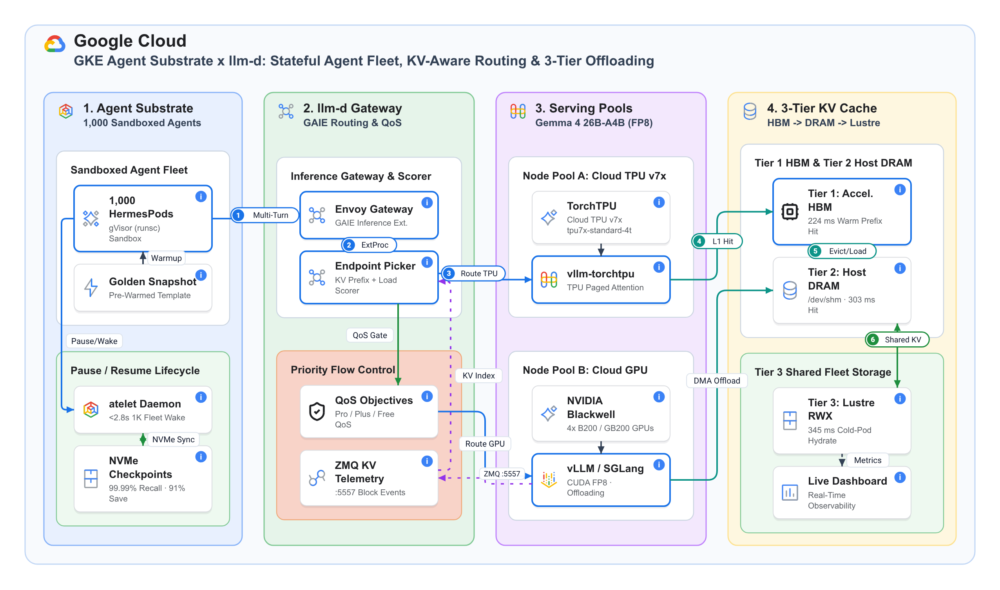
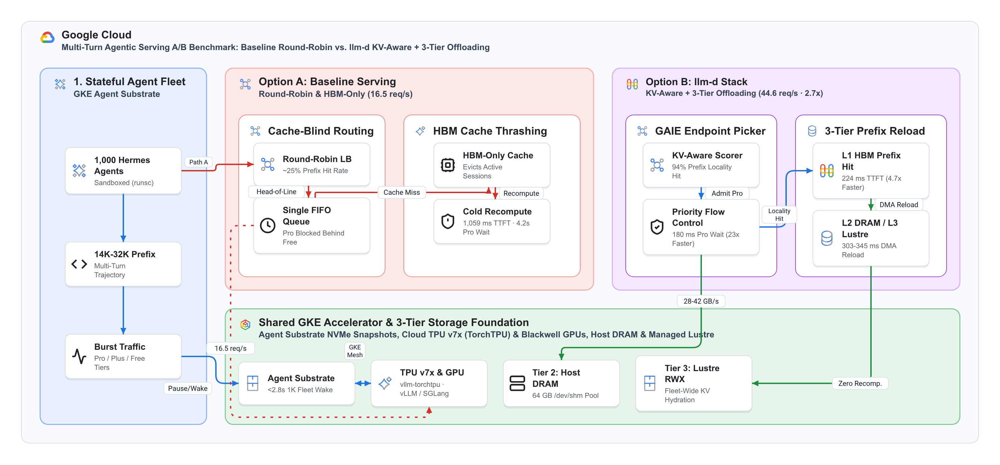

# Systems Architecture & Design Decisions

This document details the systems architecture, cross-layer interactions, and key engineering design decisions behind the **Agentic Serving Fleet** demo (`llm-d` + Agent Substrate + heterogeneous TPUs and NVIDIA GPUs).





---

## 1. Architectural Problem Statement

Running **1,000+ stateful, multi-turn AI agents** exposes four fundamental mismatches between agentic workloads and conventional cloud-native ML infrastructure:

1. **Bimodal Duty Cycle (~90% Idle vs. Correlated Wake Bursts)**:
   - An autonomous coding or research agent alternates between short LLM turns (~0.5 to 1.5 s) and much longer idle intervals waiting on user input, external APIs, or sub-agent results.
   - Pinning 1,000 dedicated Pods wastes >90% of cluster CPU and memory. Standard container scale-to-zero incurs 30 to 60 s cold-start latency and loses in-memory session state.
2. **Multi-Turn Context Growth & Prefix Recomputation**:
   - Each agent turn sends a shared ~2K-token system/tool prompt (`hermes/actor/AGENTS.md`) plus a growing multi-turn conversation history (up to 64K tokens).
   - Stateless round-robin load balancing spreads consecutive turns of the same agent across different model replicas, causing cache misses (0 to 25% prefix hit rate) and forcing full prefill recomputation on every turn.
3. **Priority Inversion Under Burst Load**:
   - When hundreds of background agents wake simultaneously (`300 req/s`), they saturate model server prefill queues and degrade Time-To-First-Token (TTFT) for interactive (`Pro / Priority`) users unless admission control is enforced above the model server.
4. **Suspend-Induced HBM Evictions**:
   - While 900+ agents pause between turns, active requests evict their KV cache blocks from accelerator HBM. Without a multi-tier KV hierarchy (`HBM -> Host DRAM -> Shared Storage`), returning agent turns suffer cold prefill misses.

---

## 2. Control & Data Plane Architecture

### 2.1 Layer 1: Agent Substrate & Stateful Hermes Sandboxes (`hermes/`, `substrate-bench/`)

```text
substrate-bench/fleet_driver (:8090 / :8092)
  │
  ├── gRPC ResumeActor / PauseActor ──▶ ate-api (:443) ──▶ atelet (Node DaemonSet)
  │                                                           │
  │                                                           ▼
  │                                               runsc-fast (gVisor Sentry)
  │                                               • Restores /data SQLite & page cache
  │                                                 from node-local NVMe snapshot
  │
  └── HTTP POST /v1/chat/completions ──▶ atenet-router (:80) ──▶ Hermes Agent (:80)
        (X-Hermes-Session-Id: agent-NNNN-gK)
```

- **Pre-Warmed Golden Snapshot (`hermes/actor/warmup.py`)**: Python + Hermes startup and first-turn init take ~3.4 s cold. Before the `ActorTemplate` golden snapshot is captured, `warmup.py` executes 3 synthetic turns against a loopback responder so Python imports, SQLite connection pools, and chat templates are paged into memory. Restored sandboxes complete their first turn in **~110 ms** of sandbox overhead.
- **Fast-Wake `atelet` & `runsc_fast_sync.c` (`patches/`)**: `patches/ateapi-atelet-fast-wake.patch` raises per-node restore concurrency (`restoreSem = 12`) and pairs with `patches/runsc_fast_sync.c` to restore all 1,000 sandboxes across 18 `c4d-standard-16` nodes in **2.44 to 2.85 s** (or **1.91 s** on 25 `c4-standard-4` nodes for light sandboxes).
- **Stateful Memory Survival (`SNAPSHOT_CONTENT_SCOPE_FULL`)**: Each Hermes sandbox persists its conversation turns in `/data` (SQLite). Because `hermes-template.yaml.tmpl` configures `onPause: SNAPSHOT_CONTENT_SCOPE_FULL`, both the filesystem and process memory survive every `PauseActor` / `ResumeActor` transition (**99.99% recall across up to 28 suspends/agent**).

### 2.2 Layer 2: `llm-d` Gateway & GAIE Endpoint Picker (`manifests/tpu/`, `llmd-harness/manifests/routing/`)

```text
Hermes Sandbox ──▶ substrate-bench LLM Proxy (:8091)
                     • Injects x-llm-d-inference-objective (premium | standard | best-effort)
                     │
                     ▼
           llm-d Envoy Gateway (:8080)
                     │  ext_proc gRPC
                     ▼
           GAIE Endpoint Picker (EPP :9002)
             ├── 1. Flow Control Queue (InferenceObjective priority 100 vs 50 vs -10)
             └── 2. Composite Scorer (Precise Prefix-Cache Scorer + Load Scorer)
                     ▲
                     │ ZMQ PUB/SUB (:5557) kv@<POD_IP>:8000@<MODEL>
         ┌───────────┴───────────┐
         │                       │
  Node Pool A (TPU v7x)   Node Pool B (NVIDIA GPUs)
```

- **Real-Time ZMQ KV Event Streaming**: Every vLLM replica runs with `--kv-events-config '{"enable_kv_cache_events":true,"publisher":"zmq","endpoint":"tcp://*:5557","topic":"kv@${POD_IP}:8000@google/gemma-4-26B-A4B-it"}'`. Whenever `vllm-torchtpu` or GPU `vLLM` allocates, offloads, or evicts a PagedAttention block, it publishes the block hash to the `llm-d` Endpoint Picker (`manifests/tpu/gaie-values-flowctl.yaml`), giving the router an exact map of which replica holds each agent's prefix blocks (**93 to 94% prefix hit rate**, **4.74x lower p50 TTFT**).
- **Priority Flow Control (`manifests/tpu/inference-objectives.yaml`)**: Defines tiered `InferenceObjective` resources (`premium`, `standard`, `best-effort`). Under a `300 req/s` burst spike, `premium` (`Pro`, priority `100`) requests bypass saturation queueing at the Endpoint Picker, maintaining **18 to 22 ms p90 queue wait** vs. **418 ms** under unprioritized FIFO queueing.

### 2.3 Layer 3: Heterogeneous Accelerators & Model Serving Engines (Reference Environment)

The live deployment scripts verify the stack on the following GKE reference pools (`manifests/tpu/`, `llmd-harness/manifests/modelserver/`):

| Pool | Node / Accelerator SKU | Supported Serving Engines | Key Optimizations |
| :--- | :--- | :--- | :--- |
| **Node Pool A: TPU v7x (Ironwood)** | `tpu7x-standard-4t` (`2x2x1`, 4 TPU v7x chips / 8 TensorCores, `768 GiB` HBM3e, `960 GiB` Host DRAM) | `TorchTPU` ([`google-pytorch/torch_tpu`](https://github.com/google-pytorch/torch_tpu)), `vllm-torchtpu` (`vLLM v0.32.0`), `sglang-torchtpu` (`SGLang v0.5.22`) | `torch.compile(backend="tpu")`, TPU Pallas `FLASH_ATTN`, `TPUCPUOffloadingSpec` L2 DRAM & L3 Lustre KV offload, Host-RAM `tmpfs` zero-copy `safetensors` `mmap` |
| **Node Pool B: NVIDIA GPUs on Google Cloud** | NVIDIA Blackwell (`B200` / `GB200`) & `g4-standard-96` (`2 x nvidia-rtx-pro-6000` Blackwell Server Edition, `192 GB` GDDR7) | `vLLM` (`v0.32.0`, CUDA FP8 / BF16, PagedAttention), `SGLang` (`v0.5.22`, RadixAttention + FlashInfer) | FlashInfer / FlashAttention-3 decode kernels, native `OffloadingConnector` / `TieringOffloadingSpec` with hybrid KV cache manager support for Gemma 4 |

### 2.4 Layer 4: 3-Tier KV Cache Offloading (`Tier 1 HBM <-> Tier 2 Host DRAM <-> Tier 3 Shared Storage`)

```text
┌────────────────────────────────────────────────────────────────────────────┐
│ Tier 1: Accelerator HBM (TPU v7x HBM3e · NVIDIA Blackwell B200/GB200 HBM)  │
│   • Active PagedAttention / RadixAttention blocks (3.2-8.0 TB/s bandwidth) │
└───────────────────────────────┬────────────────────────────────────────────┘
                                │ Async DMA Evict / Warm Prefetch (28-42 GB/s)
                                ▼
┌────────────────────────────────────────────────────────────────────────────┐
│ Tier 2: Host DRAM KV Cache Pool (/dev/shm, 64 GiB/pod · 960 GiB TPU Host)  │
│   • Retains multi-turn KV prefix blocks while Hermes sandboxes are paused  │
│   • Cuts returning-turn TTFT by 65-86% (303-357 ms vs. 1,059-2,630 ms)     │
└───────────────────────────────┬────────────────────────────────────────────┘
                                │ Shared POSIX Write-Through / Hydrate (1.95 GB/s)
                                ▼
┌────────────────────────────────────────────────────────────────────────────┐
│ Tier 3: Shared POSIX Storage (Google Cloud Managed Lustre, /mnt/lustre)    │
│   • Persists KV blocks across pod restarts (345-506 ms restore on TPU v7x) │
│   • Zero-recompute cold-replica scale-out hydration across the fleet       │
└────────────────────────────────────────────────────────────────────────────┘
```

### 2.5 Dual-Mode Dashboard Container (`dashboard/`)

The interactive UI is a single-file frontend (`dashboard/index.html`) backed by Python stdlib servers:

- **Simulator mode (`dashboard/mock_server.py`)**: Runs standalone on `:8090` with calibrated telemetry for all 5 views (`Stack`, `Agents`, `Routing & KV Cache`, `Flow Control`, `Summary`). Defaults to vendor-neutral community mode (`?cloud=neutral`), with an optional `?cloud=gcp` toggle in Settings.
- **Live + Dual mode (`dashboard/server.py`, `dashboard/entrypoint.sh`)**: Scrapes live `vLLM` `/metrics`, `llm-d` EPP telemetry, and `fleet_driver` actor state on `:8080`/`:8085` while proxying `/sim/*` to a local `mock_server.py` sidecar on `127.0.0.1:8086`.

---

## 3. Key Trade-Offs & Design Decisions

1. **Node-Local Pause (`PauseActor`) vs. Remote Object-Store Suspend (`SuspendActor`) During Active Traffic**:
   - *Decision*: Use node-local NVMe snapshot pause (`-rest-mode=pause`) for the 100 req/s active duty cycle, reserving remote GCS snapshot upload for cold cluster evacuation.
   - *Rationale*: Uploading 1,000 x 150 MB Hermes snapshots concurrently to object storage saturates node egress bandwidth. Node-local NVMe snapshots keep restore latency at **1.4 s p50** (`2.85 s` for all 1,000) with zero network egress cost.
2. **`TorchTPU` + `vllm-torchtpu` on TPUs**:
   - *Decision*: Run `vllm-torchtpu` (`torch_tpu` PJRT backend) on TPU v7x.
   - *Rationale*: Keeps standard `torch.compile(backend="tpu")` and upstream `vLLM` scheduler, ZMQ KV-event publishing, and KV offloading connectors aligned with GPU serving pools.
3. **Host-RAM `tmpfs` (`emptyDir: medium: Memory`) for Model Checkpoints on `tpu7x-standard-4t`**:
   - *Decision*: Mount `/root/.cache` on `tmpfs` rather than the node boot disk.
   - *Rationale*: `tpu7x-standard-4t` provides `960 GiB` of host DRAM vs. a default `300 GB` boot disk. Because `safetensors` uses `mmap()`, storing weights in `tmpfs` shares physical RAM pages cleanly without boot-disk pressure.
