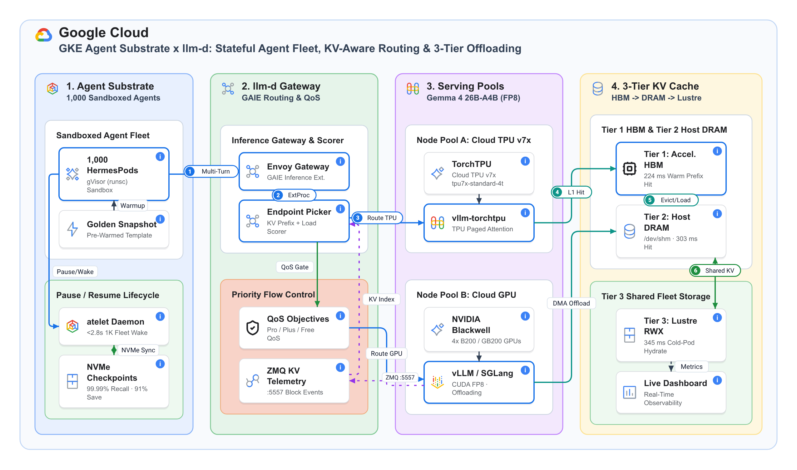
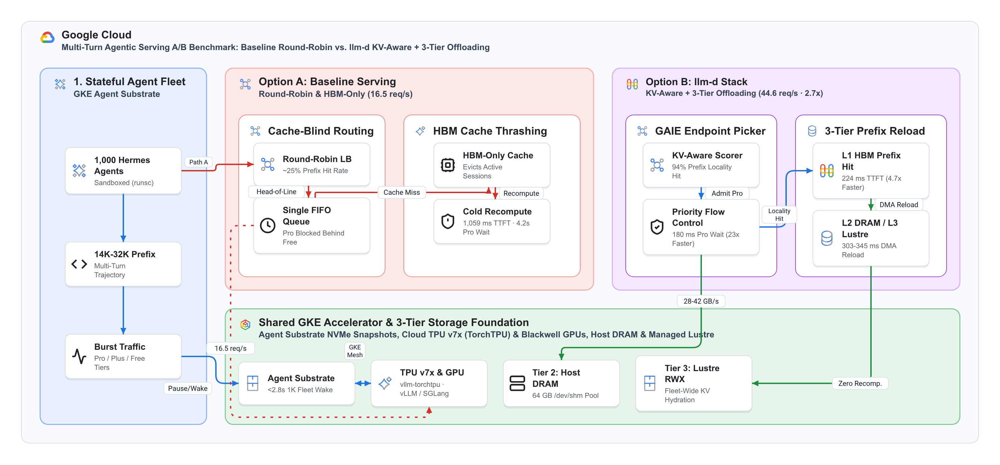

# Agentic Serving Fleet Demo

> **Status:** Active | **Capabilities:** `precise-prefix-cache-routing`, `flow-control`, `tiered-prefix-cache`, `heterogeneous-accelerators` | **Modes:** Local Simulator + Live Cluster (GKE Reference Environment)

An interactive 5-screen dashboard and end-to-end Kubernetes harness showing **1,000 stateful [Hermes](https://github.com/NousResearch/hermes-agent) agents** calling a shared model serving fleet through `llm-d` prefix-cache-aware routing, priority flow control, and 3-tier KV cache offloading across heterogeneous accelerators.



---

## Quickstart (Local Simulator or Docker)

You can run the full interactive dashboard locally in seconds with Python 3.10+ (standard library only, no cluster or accelerators required).

```bash
# From the repository root:
make sim DEMO=agentic-serving-fleet

# Or directly from this directory:
make simulate
# Open http://localhost:8090
```

Or with Docker:

```bash
docker build -t llmd-agentic-fleet-demo demos/agentic-serving-fleet
docker run --rm -p 8080:8080 llmd-agentic-fleet-demo
# Open http://localhost:8080
```

### Walking Through the Demo

- The dashboard defaults to **Neutral** community mode (`Kubernetes`, `Node pool A / B`, vendor-neutral framing). Open the gear icon in the top right (or append `?cloud=gcp`) to toggle the GKE / TPU / NVIDIA hardware labels used in the live reference environment.
- Use keys `1` through `5` (or click layers on the **Stack** view) to move across **Stack**, **Agents**, **Routing & KV Cache**, **Flow Control**, and **Summary**.
- In **Agents**, click **Wake** and **Start** to watch 1,000 sandboxed agents wake up and send multi-turn inference traffic while staying ~90% idle between turns.
- In **Routing & KV Cache**, toggle **Without llm-d** vs. **With llm-d** (and enable **Tier 2 Host DRAM** / **Tier 3 Shared Storage** on the right rail) to compare prefix-cache hit rate, TTFT, and throughput.
- In **Flow Control**, toggle priority queueing under saturation to see `Pro` requests stay fast while `Free` batch traffic queues cleanly.

Watch a narrated walkthrough recording: [llm-d Agentic Serving Demo Walkthrough (YouTube)](https://www.youtube.com/watch?v=fEFgSMLfBj0).

---

## Overview

Autonomous agents break the core assumptions of both standard pod scheduling and stateless LLM load balancing: they wake in correlated bursts, carry 2K to 64K+ token multi-turn histories, and spend ~90% of their lifecycle idle between turns.

This demo connects four layers into one visual story:

1. **Stateful Agent Fleet (`hermes/`, `substrate-bench/`)**: 1,000 sandboxed Hermes agents that pause to node-local snapshots between turns (~90% fleet idle rate) and preserve per-agent SQLite session history across suspend/resume cycles.
2. **`llm-d` Prefix-Cache-Aware Routing & Flow Control (`manifests/`, `llmd-harness/`)**: Streams real-time KV block events over ZMQ (`:5557`) to the Kubernetes Gateway API Inference Extension (GAIE) Endpoint Picker (`EPP`) and enforces `InferenceObjective` priority lanes (`Pro`, `Plus`, `Free`) under burst saturation.
3. **Heterogeneous Serving Fleet (`vLLM`, `SGLang`, `TorchTPU`)**: Serves `google/gemma-4-26B-A4B-it` across heterogeneous pools behind a unified `llm-d` routing layer.
4. **3-Tier KV Cache Offloading (`Tier 1 HBM <-> Tier 2 Host DRAM <-> Tier 3 Shared Storage`)**: Retains paused agents' prefix KV blocks past HBM eviction and hydrates cold scale-out replicas without recomputing prefixes.

### Upstream `llm-d` Guides

This demo builds on upstream production recipes in [llm-d/llm-d/guides](https://github.com/llm-d/llm-d/tree/main/guides) rather than vendoring them:

- [Precise Prefix Cache Routing](https://github.com/llm-d/llm-d/tree/main/guides/precise-prefix-cache-routing)
- [Flow Control](https://github.com/llm-d/llm-d/tree/main/guides/flow-control)
- [Tiered Prefix Cache](https://github.com/llm-d/llm-d/tree/main/guides/tiered-prefix-cache)
- [Optimized Baseline](https://github.com/llm-d/llm-d/tree/main/guides/optimized-baseline)



---

## Live Cluster Deployment & Reference Environment

The live deployment scripts in `llmd-harness/` target the verified **Reference Environment** below (following the reference environment convention in `llm-d/llm-d` guides):

| Field | Reference Environment |
| :--- | :--- |
| **Platform** | GKE 1.34+ with Agent Substrate (`ate-api`, `atelet`, gVisor `runsc`) |
| **Accelerators** | Pool A: TPU v7x (Ironwood, `tpu7x-standard-4t`, `2x2x1`) · Pool B: NVIDIA Blackwell (`B200` / `GB200`) & `G4` GPUs on Google Cloud |
| **Serving Engines** | `vllm-torchtpu` (`vLLM v0.32.0`) and `sglang-torchtpu` (`SGLang v0.5.22`) on TPUs · `vLLM` and `SGLang` on NVIDIA GPUs |
| **Model** | `google/gemma-4-26B-A4B-it` (`RedHatAI/gemma-4-26B-A4B-it-FP8-Dynamic`) |
| **Shared Storage (Optional Tier 3)** | Google Cloud Managed Lustre RWX PVC (`/mnt/lustre`) |

### Prerequisites

1. Clone upstream [llm-d/llm-d](https://github.com/llm-d/llm-d) locally (required by `60_deploy_llmd_heterogeneous.sh` for shared `guides/env.sh` and router base values):
   ```bash
   git clone https://github.com/llm-d/llm-d.git "${HOME}/llm-d"
   export LLMD_REPO="${HOME}/llm-d"
   ```
2. Export your cluster settings (or override defaults in [`llmd-harness/config/env.sh`](./llmd-harness/config/env.sh)):
   ```bash
   export PROJECT_ID="<your-gcp-project-id>"
   export CLUSTER_NAME="llmd-demo-cluster"
   export HF_TOKEN="<your-huggingface-token>"
   ```

### Deploy Steps

```bash
cd demos/agentic-serving-fleet

make preflight          # Verify CLI tools, LLMD_REPO, and cluster access
make deploy-cluster     # Provision TPU v7x, NVIDIA GPU, and Agent Substrate CPU node pools
make deploy-llmd        # Deploy llm-d gateway, EPP router, and TPU/GPU serving pools
make deploy-substrate   # Deploy Agent Substrate and 1,000 Hermes agents
make dashboard-live     # Deploy and port-forward the live dashboard on :8085
```

See [`llmd-harness/README.md`](./llmd-harness/README.md) for KV cache tiering flags (`ENABLE_KV_TIERING=1`, `ENABLE_KV_STORAGE_TIER=1`, `ENABLE_KV_OFFLOAD=1`), [`hermes/README.md`](./hermes/README.md) for the Hermes sandbox image, and [`ARCHITECTURE.md`](./ARCHITECTURE.md) for deep-dive systems architecture.

---

## Measured Results (Reference Environment)

All measurements below were captured on the GKE Reference Environment described above (`kubectl ate get actors`, node cgroup counters, vLLM Prometheus metrics, and `inference-perf`):

| Layer | Metric | Baseline (`Without`) | With `llm-d` + Agent Substrate | Observed Gain |
| :--- | :--- | :---: | :---: | :--- |
| **Agents** | Wake 1,000 light sandboxes (`25 x c4-standard-4`) | ~45.0 s cold pod start | **1,907 to 1,953 ms** (p50 `1,045 ms`) | 23x faster fleet wake, 0 failures |
| **Agents** | Wake 1,000 Hermes agents (`18 x c4d-standard-16`) | ~45.0 s cold pod start | **2,444 to 2,854 ms** (p50 `1,450 ms`) | 15x faster fleet wake, 0 failures |
| **Agents** | First-turn sandbox init overhead | `3,400 ms` cold start | **`110 ms`** (pre-warmed golden snapshot) | 30x faster first agent turn |
| **Agents** | Fleet idle rate (`100 req/s` steady duty cycle) | 0% (1,000 pods pinned) | **90.4% to 91.0% idle** (~910 paused) | ~10x compute density |
| **Agents** | Session memory recall across suspends (5 min) | Lost on scale-to-zero | **14,679 / 14,681 (99.99%)** | Survived up to 28 suspends/agent |
| **`llm-d` Routing** | Multi-turn prefix-cache hit rate | 0.0% to 25.0% | **89.0% to 94.2%** | Eliminates redundant prefill compute |
| **`llm-d` Routing** | Multi-turn TTFT (p50 / p95) | `701 ms` / `1,482 ms` | **`148 ms` / `312 ms`** | 4.74x lower p50, 4.75x lower p95 |
| **`llm-d` Flow Control** | Interactive (`Pro`) p90 queue wait (`300 req/s` burst) | `418 ms` (FIFO queue) | **`18 to 22 ms`** (`priority 100`) | 19x to 23x lower interactive queue wait |
| **Heterogeneous Serving** | 1,000-agent swarm output throughput (TPU v7x + GPU) | `1,848.8` / `3,088.7 tok/s` | **`4,361.9` / `5,614.0 tok/s`** | 1.82x to 2.36x higher cluster throughput |
| **KV Tiering (TPU)** | Evicted 6.5k-token prefix TTFT (`vllm-torchtpu` v7x) | `2,630 ms` (cold HBM miss) | **`357 ms`** (L2 DRAM) · **`345 ms`** (L3 Lustre) | 7.4x to 7.6x faster (`506 ms` cold restart) |
| **KV Tiering (GPU)** | Returning-turn TTFT after HBM eviction (Blackwell p50) | `355 to 1,059 ms` (HBM only) | **`123 to 303 ms`** (`HBM + 64 GiB/pod DRAM`) | 65% to 71% lower TTFT |
| **KV Tiering (GPU)** | Multi-turn throughput & scale-out Lustre hydration | `345 tok/s` (`16.5 req/s`) | **`931 tok/s` (`44.6 req/s`) · `1.95 GB/s` Lustre** | 2.7x throughput, zero-recompute scale-out |

---

## Directory Structure

```text
demos/agentic-serving-fleet/
├── demo.yaml               Catalog metadata (capabilities, simulator/live modes, links)
├── OWNERS                  Demo maintainers
├── ARCHITECTURE.md         Deep-dive systems architecture and trade-offs
├── Makefile                Local simulator, verify, deploy, and teardown targets
├── Dockerfile              Builds the dual-mode (live + /sim/*) dashboard image
├── dashboard/              Interactive 5-screen UI, live backend, and local simulator
├── docs/                   Architecture diagrams and screenshots
├── hermes/                 Hermes agent container image, golden-snapshot warmup, manifests
├── llmd-harness/           Reference-environment deployment scripts and KV tiering benchmarks
├── manifests/              Kubernetes manifests for Agent Substrate, llm-d, and TPU/GPU pools
├── patches/                Fast-wake patches for Agent Substrate (atelet / runsc)
└── substrate-bench/        Go load drivers for burst and steady-state benchmarks
```

---

## Operational & Security Notes for Cluster Reproduction

Several tuning steps in the live benchmark scripts are intended strictly for isolated demo clusters and must be reviewed before any multi-tenant or production use:

1. **Control-Plane Database Durability (`manifests/substrate/scale-control-plane.sh`)**: Sets `fsync=off` and `synchronous_commit=off` on a single Postgres instance for 1,000-actor burst benchmarks. Use a managed high-IOPS database with `fsync=on` in production.
2. **Host Kernel Tuning (`manifests/substrate/ate-node-tuner.yaml`)**: Runs a privileged DaemonSet to raise `fs.inotify.max_user_instances`, `net.core.somaxconn`, and ARP thresholds for >50 sandboxes per node. Apply these via GKE Node System Config in production clusters.
3. **API Credentials**: Never commit `HF_TOKEN`, `HERMES_API_KEY`, or kubeconfig files. Inject secrets at runtime via Kubernetes Secrets or an external secrets manager.

---

## Cleanup

Tear down deployed demo namespaces (add `DELETE_NODEPOOLS=1` to also remove provisioned node pools):

```bash
cd demos/agentic-serving-fleet
make teardown
```
